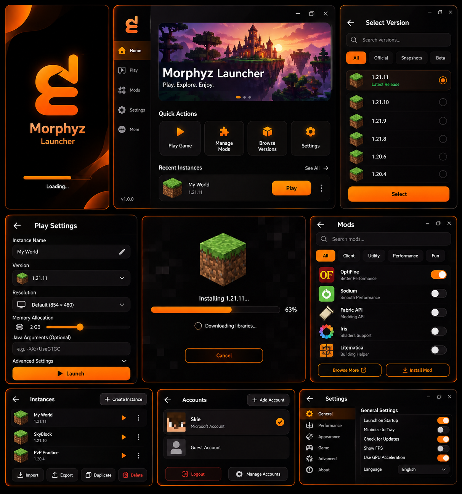

<div align="center">


# Morphyz Launcher

**Minecraft: Java Edition on Android — fast, dark and orange.**

<br>

<a href="https://github.com/manitsagar-dev/Morphyz-Launcher/releases"></a>
&nbsp;
<a href="https://github.com/manitsagar-dev/Morphyz-Launcher/actions/workflows/build-apk.yml"></a>
&nbsp;

&nbsp;


<br><br>



<sub>Design concept for the landscape UI (orange-on-obsidian theme) — screens shown are the redesign in progress, not shipped screenshots yet.</sub>

</div>

---

## What is Morphyz Launcher?

Morphyz Launcher lets you play **Minecraft: Java Edition** on your Android phone or tablet — every
release from the earliest alphas to the newest snapshots, with the full mod-loader stack, shaders,
resource packs and one-tap modpack installs from Modrinth and CurseForge.

> You need your own Minecraft: Java Edition account (or a local guest account for offline play) to play.
> Morphyz Launcher is not affiliated with Mojang Studios or Microsoft and ships none of their code or assets.

**Morphyz Launcher is a fork and rebrand of [CS Launcher Plus](https://github.com/craftstudioteam/CS-LAUNCHER-PLUS) by Craft Studio Development Group**, which is itself built on [PojavLauncher](https://github.com/PojavLauncherTeam/PojavLauncher) and its [Amethyst-Android](https://github.com/AngelAuraMC/Amethyst-Android) fork.

---

## Features

- **Every Minecraft: Java Edition version** — release, snapshot, beta and alpha, including the latest 26.x builds.
- **Full mod-loader stack** — Fabric, Forge, NeoForge, Quilt and OptiFine, one tap to install.
- **Built-in mod & modpack browser** — search and install from Modrinth and CurseForge without leaving the launcher.
- **Accounts** — local (offline) accounts by default, plus Microsoft, Ely.by and custom Yggdrasil servers (authlib-injector).
- **Automatic Java runtime setup** — downloads and configures the right runtime for your device on first launch.
- **Performance tooling** — renderer picker (Holy GL4ES / ZINK (VULKAN) / Freedreno / LTW (OpenGL ES 3), plus MobileGlues / Krypton Wrapper when bundled), JVM tuning presets and a thermal governor.
- **Touch & gamepad controls** — on-screen controls with a full gamepad button-remapper.
- **Worlds & servers** — world manager with backup/export, and a server hub with live ping.
- **Capes & skins** — cape browser and skin management (upload, switch, reset).
- **Shortcuts** — pin any profile straight to your home screen.
- **Themes** — premium dark design system with per-theme presets.
- **Landscape-only UI** — the whole launcher runs and is locked to landscape.

---

## Install

1. Download the latest APK from
   [Releases](https://github.com/manitsagar-dev/Morphyz-Launcher/releases/latest) —
   or grab the build artifact from the latest
   [Actions run](https://github.com/manitsagar-dev/Morphyz-Launcher/actions/workflows/build-apk.yml).
2. Allow installs from your browser / file manager if Android asks.
3. Open the launcher, accept the terms, add an account (local is fine) and press **PLAY**.

| | Minimum | Recommended |
|:--|:--|:--|
| Android | 5.0 | 10+ |
| CPU | arm64-v8a / armeabi-v7a | arm64-v8a |
| RAM | 2 GB | 4 GB+ (mods / 1.17+) |
| Storage | ~1 GB + game files | 4 GB+ free |

---

## Building from source

Requirements: **JDK 17**, Android SDK (platform `android-34`, build-tools `34.0.0`) and **NDK `27.3.13750724`**
(`sdkmanager "ndk;27.3.13750724"` — CI falls back to the latest NDK r27 automatically).

```bash
git clone https://github.com/manitsagar-dev/Morphyz-Launcher.git
cd Morphyz-Launcher
./gradlew assembleDebug
# APK: app_pojavlauncher/build/outputs/apk/debug/app_pojavlauncher-debug.apk
```

Notes:

- The CurseForge mod browser needs an API key in `app_pojavlauncher/curseforge_key.txt` or the
  `CURSEFORGE_API_KEY` env var. Without it the build still succeeds; CurseForge browsing is disabled.
- `app_pojavlauncher/google-services.json` is **not** required. Without it the app builds fine and
  Firebase features (remote announcements / update channel) are simply disabled. Drop your own
  `google-services.json` (package `com.cslaucher.plus`) in place to enable them.
- Every push to `main` is built automatically by GitHub Actions
  ([build-apk.yml](.github/workflows/build-apk.yml)); the debug APK is attached as a build artifact.
- Release builds are signed with `app_pojavlauncher/debug.keystore` for debug, and with your own
  keystore via `-PsigningKeystore=… -PsigningStorePassword=… -PsigningKeyAlias=… -PsigningKeyPassword=…`
  for release. Do **not** ship builds signed with the old upstream keystore.

---

## License and credits

Morphyz Launcher is free software under the **GNU General Public License v3.0** — see [LICENSE](LICENSE)
and [NOTICE](NOTICE) for the full source-offer and attribution.

- Forked from **CS Launcher Plus** by **Craft Studio Development Group** (upstream attribution preserved in NOTICE).
- Built on **PojavLauncher** (LGPL family components) and **Amethyst-Android**.
- Bundled components and their licenses: OpenJDK, LWJGL, GLFW/SDL, Holy GL4ES, Mesa/Zink, LTW,
  MobileGlues — see the in-app **About › Legal › Open source notices** and `assets/licenses`.

Minecraft is a trademark of Mojang Synergies AB / Microsoft. "Craft Studio", "CS Launcher Plus",
"Morphyz Launcher" and related marks belong to their respective owners.

## Community & support

- **Issues / feature requests:** [GitHub Issues](https://github.com/manitsagar-dev/Morphyz-Launcher/issues) —
  share logs from the in-app **Share log** button.
- **Community:** <https://discord.gg/bpgYQMA59D>
